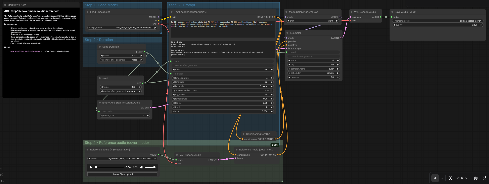

# ACE-Step 1.5 cover mode for ComfyUI

A ComfyUI workflow that turns an existing track into a new one: **the arrangement, rhythm and energy curve come from a reference audio file, the sound and style come from your prompt.** Think of it as style transfer for music. It works at the level of the arrangement, not only the timbre.

ACE-Step 1.5 can do this out of the box: the model card lists "cover generation" among its features. ComfyUI ships the node that enables it (`ReferenceTimbreAudio`, shown as *Reference Audio*), but marks it experimental, and none of the bundled ACE-Step templates wire it up. This workflow does.



## What it does

```
reference.mp3 ──► VAE Encode Audio ──► Reference Audio ──► KSampler ──► VAE Decode ──► MP3
                                         ▲
tags + structure text ──► Text Encode ───┘
```

When the conditioning carries a reference latent, ComfyUI switches ACE-Step into cover mode (`is_covers`). The language model that normally invents the song's "audio codes" is skipped, and the diffusion model follows the reference instead. The result keeps where the drops, breaks and builds of the reference sit, and re-renders them with the instruments and mood you describe.

Despite the node's name, it is more than a timbre reference. Feed it a drum loop and you get a track that grooves like that loop. Feed it a full song and you get a re-imagined version of that song.

## Requirements

- A recent ComfyUI with ACE-Step 1.5 support. Tested on ComfyUI 0.21.1.
- The model, into `ComfyUI/models/checkpoints/`:
  [ace_step_1.5_turbo_aio.safetensors](https://huggingface.co/Comfy-Org/ace_step_1.5_ComfyUI_files/resolve/main/checkpoints/ace_step_1.5_turbo_aio.safetensors)
- Tested on a 16 GB laptop GPU (RTX 3080 Laptop) with `--lowvram`.

## Use

1. Drag `workflows/acestep-1.5-cover.json` onto the ComfyUI canvas.
2. In **Step 4**, upload your reference with the *Reference audio* node.
3. Set **Song Duration** and the encoder's **bpm** to match the reference.
4. Write the tags and the structure text. Run.

## Settings that matter

| Setting | Why |
|---|---|
| Reference length ≥ Song Duration | After the reference ends, the model is conditioned on silence. Loop or extend short material. |
| `bpm` = reference tempo | The prompt tempo and the reference tempo should agree. |
| `generate_audio_codes` off | The audio-code LM is bypassed in cover mode, so running it only costs time. |
| `cfg_scale`, `temperature`, `top_p`, `top_k`, `min_p` | **No effect in this mode.** They only steer the audio-code LM. |
| Turbo model: steps 8, KSampler cfg 1 | The distilled model is made for this; raising cfg breaks it. |
| `seed` on *increment* | Each run gives a new take; keep the seeds you like. |

What does change the result: the **reference** itself, the **tags**, the **structure text** (section labels with lengths, such as `[Intro] 16s`, and a bracketed description per section), and the **seed**.

## Tips

- **Build your reference on purpose.** A plain four-on-the-floor kick loop gives the model a solid grid; layer sound effects or textures on top, and the output picks up their character.
- **Short, beatless sounds make weak references.** The model has no rhythm to follow and falls silent when the sound ends.
- **Describe sounds, not artists.** The model understands instruments and moods better than names.

## Rights

- The workflow is MIT licensed, see [LICENSE](LICENSE).
- ACE-Step 1.5 is MIT licensed, and its model card allows commercial use of generated music.
- **The reference is your responsibility.** A cover of a copyrighted track is a derivative of that track. Publish only what you made from material you own or are allowed to use.
